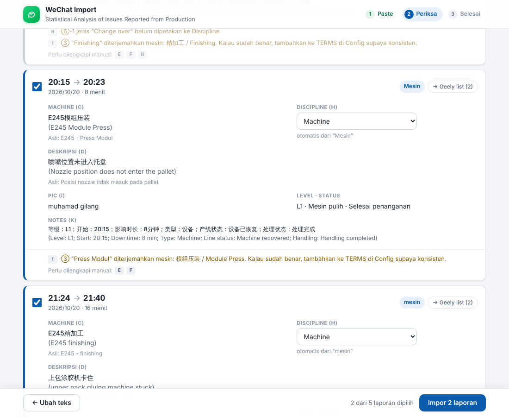

# WeChat Import

Mengubah laporan masalah produksi dari grup WeChat (format ①–⑨) menjadi baris di spreadsheet
**Statistical Analysis of Issues Reported from Production**. Google Apps Script + Google Sheets.
Kode di-paste manual ke editor Apps Script (tanpa clasp): **cukup 2 file dari folder [`dist/`](dist/)**.

```
PASTE teks WeChat → PERIKSA (centang, pilih Discipline, cek terjemahan) → IMPOR → lengkapi kolom kosong (tanya mentor)
```



*Contoh layar Periksa. Teks Mandarin di gambar berasal dari penerjemah palsu di test, bukan Google Translate.*

---

## 1. Struktur

| File | Isi |
|---|---|
| **`dist/Code.gs`** | **Yang di-paste ke Apps Script.** Semua kode server (Config + Parser + Sheet + Ui) dalam satu file |
| **`dist/Index.html`** | **Yang di-paste ke Apps Script.** UI lengkap (Index + Styles + App) dalam satu file |
| `dist/appsscript.json` | Manifest |
| `src/` | Sumber asli, dipecah per bagian. `dist/` dibuat dari sini dengan `npm run build`. **Jangan edit `dist/` langsung** |
| `src/Config.gs` | **Semua** konfigurasi: sheet per proyek, `DISCIPLINE_MAP`, jenis yang dilewati, kolom, warna, format |
| `src/Translate.gs` | Terjemahan ke format manajer `中文\n(English)` + menu *Terjemahkan sel terpilih* |
| `src/Parser.gs` | Fungsi murni (tanpa `SpreadsheetApp`): `parseReports`, `parseOne`, `parseDateTime`, pemetaan ke kolom |
| `src/Sheet.gs` | `findNextRow`, `writeRecord`, `previewWeChat`, `importWeChat`, pengaman sheet, deteksi duplikat |
| `src/Template.gs` | Menu **Buat sheet baru**: format sheet manajer + `createIssueSheet` |
| `src/Ui.gs` | `setup` (izin + cek konfigurasi), `onOpen` (menu), `showImportDialog`, `showNewSheetDialog`, `doGet` (web app), `getInitData` |
| `src/Index.html`, `App.html`, `Styles.html` | UI: satu halaman, 3 langkah. Dipakai di dialog menu **dan** web app |
| `src/appsscript.json` | Manifest: timezone `Asia/Shanghai`, runtime V8, izin minimum |
| `test/` | Test Node tanpa Google: parser, penulisan sheet, pembuatan sheet baru (dengan mock) |

---

## 2. Setup pertama kali (±15 menit)

> **Coba dulu di salinan** (File → *Make a copy*), bukan langsung di file manajer.

1. **Convert .xlsx ke Google Sheets.** Upload file ke Google Drive → buka → **File → Save as Google Sheets**.
   Kerjakan di file Google Sheets hasilnya. (File .xlsx yang dibuka langsung masih "Office mode",
   menu Extensions → Apps Script tidak tersedia.)
   *Mulai dari spreadsheet kosong juga bisa:* lewati langkah ini, lalu setelah setup buat sheet lewat
   **WeChat Import → Buat sheet baru** (bagian 3a).
2. Di spreadsheet itu: **Extensions → Apps Script**.
3. Paste **2 file** dari folder [`dist/`](dist/) (di GitHub: buka file → tombol *Copy raw file*):
   - **`Code.gs`** (sudah ada bawaan): hapus semua isinya → paste isi [`dist/Code.gs`](dist/Code.gs).
   - **+ → HTML** → beri nama **`Index`** → hapus isinya → paste isi [`dist/Index.html`](dist/Index.html).

   Jangan campur dengan file dari `src/`: kalau fungsi yang sama ada di dua file, yang terakhir dimuat yang
   dipakai, dan itu membingungkan saat debug.
4. **Project Settings** (ikon gerigi) → centang **Show "appsscript.json" manifest file in editor** →
   kembali ke Editor, ganti isi `appsscript.json` dengan [`dist/appsscript.json`](dist/appsscript.json). Simpan (Ctrl+S).
5. **Run `setup`**: di toolbar editor pilih fungsi **`setup`** → **Run**. Pertama kali Google meminta izin:
   Review permissions → pilih akun → *"Google hasn't verified this app"* → Advanced → Go to … (unsafe) → Allow.
   Izin yang diminta hanya: spreadsheet **ini** saja + menampilkan dialog.
   `setup` **tidak mengubah data**. Yang dilakukan:
   - menyamakan timezone spreadsheet dengan manifest (`Asia/Shanghai`). Tool menulis tanggal/jam sebagai
     nomor seri, jadi hasil impor tidak bergantung timezone; ini supaya konsisten saja;
   - memeriksa: sheet dengan header baris 8, sheet tujuan tiap proyek (`PROJECT_SHEET`), dan apakah
     `DISCIPLINES` cocok dengan dropdown kolom H (kalau tidak cocok, impor akan ditolak Sheets).

   Hasilnya ada di **Execution log** di bawah editor. Baris `✗` = harus dibereskan dulu.
   Aman dijalankan berulang; nanti bisa juga lewat menu **WeChat Import → Cek setup** (hasilnya muncul sebagai pop-up).
6. Reload tab spreadsheet → menu **WeChat Import** muncul di menu bar.
7. *(Opsional)* **Web app**: Deploy → **New deployment** → ⚙ **Web app** →
   Execute as: **Me** · Who has access: **Only myself** → Deploy → salin URL berakhiran `/exec`, bookmark.

### Update kode
- Paste ulang `dist/Code.gs` dan/atau `dist/Index.html` → Simpan. Menu/dialog langsung memakai kode baru.
- Web app: **Deploy → Manage deployments** → ikon pensil → Version: **New version** → Deploy.
  Jangan "New deployment" (URL-nya berubah).

---

## 3. Cara pakai

1. Di WeChat, copy laporan. Boleh beberapa sekaligus; teks obrolan lain di sela-selanya diabaikan.
2. Spreadsheet → **WeChat Import → Import laporan WeChat…** (atau buka URL web app).
3. Paste → **Proses laporan** (Ctrl+Enter).
4. **Periksa** setiap kartu:
   - Centang = akan ditulis. **Change over default tidak dicentang** (lihat bagian 6).
   - Laporan yang sudah ada di sheet ditandai **"sudah ada: … baris N"** dan tidak dicentang.
   - Discipline bisa dipilih manual; kosong = sel H dibiarkan kosong.
   - Machine, Deskripsi, dan Notes tampil persis seperti yang akan ditulis (中文 lalu (English)), plus teks aslinya.
     Baca baris English-nya: kalau artinya melenceng, terjemahan Mandarinnya juga melenceng.
   - Peringatan menunjukkan field yang gagal terbaca + kolom yang terdampak.
5. **Impor N laporan.**
6. Halaman **Selesai**: link langsung ke tiap baris, dan **Pertanyaan untuk mentor** (tombol *Salin*)
   berisi Root Cause, Solusi, dan semua kolom kosong lain per laporan, siap dikirim.
7. Setelah dapat jawaban, ketik Root Cause/Solution dalam Bahasa Indonesia di E/F, pilih sel-selnya, lalu
   **WeChat Import → Terjemahkan sel terpilih (中文 + English)**. Teks asli disimpan di catatan sel.

### 3b. Terjemahan
- **Format** sama dengan sheet manajer: Mandarin, lalu baris baru, lalu Inggris dalam kurung.
  - C: `E245精加工` / `(E245 Finishing)`, seperti `E245模组入箱` / `(E245 module installation into enclosure)`.
  - D: terjemahan deskripsi.
  - K: `等级：L1；开始：18:05；影响时长：18分钟；类型：换型；…` / `(Level: L1; Start: 18:05; Downtime: 18 min; Type: Changeover; …)`.
- **Tidak diterjemahkan:** H (harus sama dengan isi dropdown), I (nama orang), G/J (jam/tanggal).
- **Mesin:** Google Translate bawaan Apps Script (gratis, tanpa API key). Indonesia → English → 中文, jadi kedua
  bahasa mengatakan hal yang sama. Semua teks satu impor dikirim sekaligus (±2 panggilan per pratinjau/impor).
- **Istilah tetap** di `TERMS` (Config) tidak lewat mesin: changeover → 换型, Preassy → 预装 (keduanya dari file
  manajer), status operator (Mesin pulih, Selesai penanganan, …). `ZH_FIXES` mengganti 模块 → 模组 seperti di file manajer.
- **Nama proses (③) yang belum ada di `TERMS`** diterjemahkan mesin dan diberi peringatan. Tanyakan nama Mandarin
  resmi stasiun (Finishing, Press Modul, …) ke mentor/manajer **sekali**, masukkan ke `TERMS`, maka C konsisten.
- **Teks asli Indonesia** disimpan sebagai **catatan sel** (segitiga kecil di pojok, muncul saat kursor di atasnya):
  C & D berisi teks aslinya, K berisi field asli + semua peringatan. Deteksi duplikat memakai teks asli ini.
- **Kalau terjemahan gagal** (kuota habis, jaringan): tidak ada yang ditulis; layar Periksa menawarkan
  *Coba lagi* atau *Lanjut tanpa terjemahan*. Mematikan permanen: `TRANSLATE = false` di Config.

### 3a. Buat sheet baru (format manajer)
Menu **WeChat Import → Buat sheet baru (format manajer)…**, atau tautan **+ Sheet baru** di sebelah
"Sheet untuk proyek lain". Isi:
- **Nama sheet** (wajib, tidak boleh sama dengan sheet yang sudah ada).
- **Nama proyek**: teks besar di B4. Kosong = sama dengan nama sheet.
- **Kode proyek ②** (opsional), mis. `L7`: laporan dengan `②Nama proyek: L7` (huruf besar/kecil, spasi,
  strip diabaikan) otomatis masuk ke sheet ini. Kode disimpan di sheet itu sendiri (metadata tersembunyi),
  jadi tetap jalan walau sheet di-rename, dan hilang kalau sheet dihapus. Satu kode hanya untuk satu sheet.

Yang dibuat **sama persis dengan "LImo 7 list"** milik manajer (dicek sel per sel terhadap file xlsx):
header bilingual baris 8, Status Overview G1:I5 + rumus `COUNTIF` aslinya, legenda A1:A5, judul B6:G6,
pita abu-abu baris 6–7, warna, font, rata, wrap, garis, lebar kolom, tinggi baris 1–8, freeze baris 8,
gridline tersembunyi, warna tab, nomor 1–14 di B9:B22, rumus `Total tasks` `=COUNT(B9:B204)-3`,
dropdown Discipline H9:H35 (dari I2:I5), dan conditional format N/A/G/Y/R di H9:H35.

Kalau sheet **Revision_History** belum ada, ikut dibuat (judul B6 membaca nomor revisinya) dengan format aslinya,
**hanya header**: riwayat revisi manajer tidak disalin, jadi judulnya "REV 0".

Yang **tidak** bisa sama persis:
- **Zoom 90%** tidak bisa diatur lewat Apps Script (atur manual: View → Zoom).
- **Font 宋体 (SimSun)** diset, tapi tampil sebagai font pengganti di komputer yang tidak punya SimSun.
- **Lebar kolom** dikonversi dari satuan Excel (× 7 px), bisa beda beberapa piksel dari hasil convert Google.
- **Format baris data**: baris terisi di file manajer tidak konsisten (font 10/11, ada yang tebal). Dipakai satu
  format seragam yang paling sering dipakai: SimSun 10 (H & J 11), rata tengah, D/E/K rata kiri, wrap.

---

## 4. Aturan pemetaan

| Kolom | Isi |
|---|---|
| **B** No.序号 (*xùhào*, nomor urut) | Kalau sudah ada nomor, tidak diubah. Kalau kosong: nomor terbesar di atasnya + 1 |
| **C** Machine | `②③中文` / `(② ③ English)`, mis. `E245精加工` / `(E245 Finishing)`. Tanpa terjemahan: `E245 - Finishing` |
| **D** Issue Description | ⑤ → `中文` / `(English)` (multi-baris dipertahankan) |
| **E** Root Cause, **F** Solution | **Selalu kosong**, tanpa warna. Diisi manual, lalu bisa diterjemahkan lewat menu |
| **G** End Time | Jam dari ⑧, format `h:mm` |
| **H** Discipline | ⑥-1 lewat `DISCIPLINE_MAP` (huruf besar/kecil, spasi, strip diabaikan). Tidak terpetakan → kosong + peringatan |
| **I** Responsibility | ⑥-2 tanpa `@`, digabung `", "` |
| **J** Date | Tanggal dari ④, format `yyyy/mm/dd` |
| **K** Notes | Level ①, jam mulai ④, durasi, jenis ⑥-1, ⑦-1, ⑦-2 dalam `中文` / `(English)`. Peringatan ada di catatan sel K |

**Tidak ada sel yang diwarnai.** Baris yang ditulis tool latarnya dikembalikan polos (sisa kuning dari versi lama
ikut hilang). Kolom yang masih harus dilengkapi tampil di layar Periksa, layar Selesai, dan teks pertanyaan mentor.

- **Sheet tujuan:** proyek di `PROJECT_SHEET` (E245 → `Geely list (2)`); proyek lain → sheet yang dipilih di UI.
- **Baris tujuan:** baris pertama mulai baris 9 yang **C dan D-nya kosong**.
- **Urutan:** dari jam kejadian (tanggal + jam ④) paling awal. Laporan tanpa ④ yang valid ditaruh paling akhir.
- **Durasi** selalu dihitung ulang dari ④ → ⑧. Kalau beda dengan ⑨ → peringatan. Lewat tengah malam ditangani.
- Teks di C/D/I yang diawali `=` `+` `-` `@` atau mirip angka diberi awalan `'` (tidak terlihat), supaya
  Sheets tidak membacanya sebagai rumus. Contoh: deskripsi berpoin `- lem habis` tanpa ini jadi `#ERROR!`.

Contoh Notes (K) dan catatan selnya:
```
等级：L1；开始：18:05；影响时长：18分钟；类型：换型；产线状态：设备已恢复；处理状态：处理完成
(Level: L1; Start: 18:05; Downtime: 18 min; Type: Changeover; Line status: Machine recovered; Handling: Handling completed)

[catatan sel K]
Asli (ID): Level: L1 | Jenis: Change over | Lini: Mesin pulih | Penanganan: Selesai penanganan
⚠ ⑥-1 jenis "Change over" belum dipetakan ke Discipline
```

### Ketahanan parser
Parsing dikunci pada **simbol** ①–⑨ dan ⑥-1/⑥-2, ⑦-1/⑦-2, bukan teks labelnya. Tahan terhadap:
spasi tidak konsisten (`2026.10.20/ 21:24`), `:` atau `：`, angka/tanda baca full-width, huruf besar/kecil,
⑨ dengan/tanpa "menit", baris diawali spasi, CRLF, spasi khusus @mention WeChat, beberapa laporan sekaligus,
laporan yang lupa menulis ①, dan `⑥` tanpa `-1/-2`. Jam boleh `18:05` atau `18.05`.

### Jangan mengarang data
Field yang gagal terbaca **dikosongkan**, dan teks aslinya dicatat di catatan sel K (atau di K, tanpa terjemahan). Khususnya:
- Tanggal hanya dibaca kalau **tahun.bulan.tanggal**. `20/10/2026` ditolak (DD/MM vs MM/DD ambigu); `26.10.20` ditolak (tahun 2 digit).
- Field teks tanpa `:` ditolak (label & isi tidak bisa dipisah dengan pasti).
- ⑧ tanpa tanggal → durasi tidak dihitung (tidak diasumsikan hari yang sama).
- Laporan tanpa Machine **dan** Deskripsi tidak ditulis (baris itu akan dianggap kosong dan tertimpa impor berikutnya).

---

## 5. Konfigurasi (`src/Config.gs`)

| Nama | Gunanya |
|---|---|
| `PROJECT_SHEET` | Proyek → sheet. Kunci huruf besar tanpa spasi/strip (`'E245'`). Menang atas kode dari menu *Buat sheet baru*, kecuali sheet-nya tidak ada |
| `DISCIPLINE_MAP` | Jenis ⑥-1 → Discipline. **Tambahkan hanya yang sudah pasti** |
| `SKIP_TYPES` | Jenis ⑥-1 yang default tidak dicentang (`'changeover'`) |
| `DISCIPLINES` | Harus sama persis dengan dropdown di sheet (`I2:I5`) |
| `HEADER_CHECK` | Teks awal B8, C8, D8. Sheet lain tidak akan pernah ditulisi |
| `TRANSLATE` | `true` = C, D, K diterjemahkan ke `中文\n(English)`; `false` = Bahasa Indonesia apa adanya |
| `TERMS` | Istilah tetap `[中文, English]` yang tidak lewat mesin. **Tambahkan nama proses (③) di sini** |
| `ZH_FIXES` | Ganti kata hasil mesin dengan istilah file manajer (`模块` → `模组`) |
| `ROW`, `COL`, `FORMAT` | Posisi header/data, nomor kolom, format G/J |

---

## 6. Keputusan yang belum dibuat

1. **"Change over" masuk Discipline apa?** Belum diputuskan → baris di `DISCIPLINE_MAP` masih dikomentari.
   Sesuai instruksi terakhir, change over (mis. pergantian lem) **default tidak diimpor**: tetap tampil di
   layar Periksa tapi tidak dicentang. Kalau dicentang manual, H kosong, kecuali Discipline dipilih.
   Setelah diputuskan: aktifkan baris di `DISCIPLINE_MAP`, dan hapus `'changeover'` dari `SKIP_TYPES` kalau
   memang harus ikut diimpor.
2. **Nama Mandarin resmi untuk proses (③)** seperti Finishing dan Press Modul: belum ada, jadi masih diterjemahkan
   mesin (dan diberi peringatan). Tanyakan ke mentor/manajer lalu isi `TERMS`.

---

## 7. Batasan & risiko (baca sebelum dipakai)

1. **Label dari operator dipercaya apa adanya.** Contoh nyata di data uji: laporan 19:15 berlabel *Change over*,
   isinya *"mesin lem upper pack stuck saat peroses pengeleman"* (mesin macet 12 menit). Laporan itu ikut
   **tidak dicentang**. Selalu baca kartu "default tidak diimpor" sebelum menekan Impor.
2. **Deteksi duplikat** membandingkan Machine + Deskripsi + End Time + Date di sheet (untuk C/D yang
   diterjemahkan: teks asli dari catatan sel). Kalau catatan selnya dihapus atau teksnya diketik ulang manual,
   paste ulang chat yang sama **tidak** terdeteksi sebagai duplikat.
3. **Terjemahan mesin bisa salah**, terutama untuk bahasa lapangan dan typo operator ("peroses pengeleman").
   Manajer membaca Mandarin-nya, jadi cek baris English di layar Periksa sebelum impor. Teks asli selalu ada di
   catatan sel. Kuota Google Translate: ±5.000 panggilan/hari (akun Gmail).
4. **Izin LanguageApp belum terverifikasi di dokumentasi resmi**: `setup` menjalankan satu terjemahan uji dan
   melaporkan `✓`/`✗`, jadi masalah izin ketahuan sebelum impor.
5. **Dropdown H** di file asli hanya ada di `H9:H35`. Mulai baris 36 tidak ada dropdown. Tool tetap menulis
   nilai yang valid, tapi tidak menambah validasi ke sheet manajer.
6. **`LImo 7 list` baris 15–17**: J sudah berisi tanggal tapi C & D kosong → dianggap baris kosong; J akan
   ditimpa tanggal laporan.
7. **Kolom J baris lama** tersimpan sebagai angka berformat *General* (tampil `46313`). Baris dari tool tampil
   `2026/10/20`. Tool tidak mengubah baris lama.
8. **F5 "Total tasks"** = `COUNT(B9:B204)-3` menghitung nomor yang sudah diisi di muka (sekarang 11, padahal
   isinya 9). Itu rumus sheet manajer, bukan dari tool. Sheet dari menu *Buat sheet baru* **sengaja** memakai
   rumus & nomor 1–14 yang sama (keputusan: sama persis), jadi sheet kosong pun menunjukkan 11.
9. **Baris 36 dst.** di sheet manajer maupun sheet buatan menu tidak punya garis & dropdown. Tool tetap menulis
   ke sana, tapi tanpa format.
10. **Web app "Only myself"**: hanya pemilik yang bisa membuka. Kalau orang lain perlu memakainya, mereka butuh
   akses Editor ke spreadsheet + deployment *Execute as: User accessing*, dengan risiko yang sama seperti proyek MTTR.

---

## 8. Troubleshooting

| Gejala | Penyebab paling mungkin | Solusi |
|---|---|---|
| Ragu setup sudah benar | – | **WeChat Import → Cek setup** (atau Run `setup`): semua baris harus `✓` |
| Menu **WeChat Import** tidak muncul | Tab belum di-reload setelah paste kode, atau `onOpen` salah ketik | Reload tab spreadsheet; pastikan file `Ui` berisi fungsi `onOpen` |
| "Tidak ada sheet dengan header di baris 8" | Header B8:D8 berubah, atau script dibuat bukan dari spreadsheet ini | Cek B8 = `No.序号`, C8 = `Machine`, D8 = `Issue Description…`; buat script lewat Extensions → Apps Script di spreadsheet yang benar; atau buat sheet lewat **WeChat Import → Buat sheet baru** |
| "Sheet "Geely list (2)" tidak ditemukan" | Nama sheet berubah | Sesuaikan `PROJECT_SHEET` di `Config.gs` |
| "…violates the data validation rules" di H | `DISCIPLINES` ≠ isi dropdown `I2:I5` | Samakan persis (huruf besar/kecil & spasi) |
| "Tidak ada laporan terdeteksi" | Simbol ①–⑨ hilang (mis. teks hasil OCR/screenshot) | Copy teks asli dari WeChat |
| Tanggal tampil sebagai angka | Format sel J diubah | Format → Number → Custom: `yyyy/mm/dd` |
| "Masih ada impor lain yang berjalan" | Dua impor bersamaan | Tunggu beberapa detik, coba lagi |
| Error lain | – | Editor Apps Script → **Executions** untuk stack trace |

---

## 9. Test

```bash
npm test        # node --test test/*.test.js (Node 18+), tanpa dependency
npm run build   # buat ulang dist/ setelah mengubah src/
```

- `test/parser.test.js`: 5 laporan asli di `test/fixtures/sample.txt` + kasus rusak (field hilang, tanggal
  salah, tanpa `:`, teks tanpa ①–⑨, ⑨ beda, ⑧ < ④, lewat tengah malam, duplikat).
- `test/sheet.test.js`: penulisan dengan mock Sheets yang meniru file manajer (baris tujuan, nomor B,
  tanpa warna, pengaman sheet, duplikat, urutan tulis) dan terjemahan dengan penerjemah palsu (format
  `中文\n(English)`, TERMS, ZH_FIXES, satu panggilan per bahasa, gagal → tidak menulis, menu terjemahkan sel).
- `test/template.test.js`: menu *Buat sheet baru* (isi & struktur sama dengan file manajer, Revision_History,
  rute kode proyek termasuk rename/hapus sheet, nama/kode dobel ditolak, spreadsheet kosong).
- `test/dist.test.js`: `dist/` harus sama dengan hasil build dari `src/` (gagal kalau lupa `npm run build`),
  dan `dist/Code.gs` harus jalan sendirian.

Hasil yang diharapkan dari fixture:

| ④ | ⑧ | Durasi | ⑥-1 → H | Default |
|---|---|---|---|---|
| 17:20 (`17.20`) | 17:40 | 20 | Change over → kosong + ⚠ | tidak diimpor |
| 18:05 | 18:23 | 18 | Change over → kosong + ⚠ | tidak diimpor |
| 19:15 | 19:27 | 12 | Change over → kosong + ⚠ | tidak diimpor |
| 20:15 | 20:23 | 8 | Mesin → Machine | diimpor |
| 21:24 | 21:40 | 16 | mesin → Machine | diimpor |

Tidak ada selisih ⑨. PIC 18:05 = `iqbal, M Arif Rahman, Muhamad gilang`.

**Tidak** diuji otomatis: perilaku asli Google (izin, validasi dropdown, tampilan dialog). Cek manual sekali
setelah setup: impor fixture ke **salinan** spreadsheet dan bandingkan dengan tabel di atas.

---

## 10. Deviasi dari brief awal (sengaja)

| Brief | Implementasi | Alasan |
|---|---|---|
| `Code.gs` direfaktor | Ditulis baru | `Code.gs` tidak ada di repo mana pun |
| clasp + `src/Dialog.html` | Paste manual; UI web app **dan** dialog menu dari file yang sama | Permintaan terbaru: tanpa koneksi langsung, paste seperti proyek MTTR |
| Ekspektasi 18:05, 19:15, 20:15, **20:30**, 21:24; durasi 18, 12, 8, **13**, 16 | 17:20, 18:05, 19:15, 20:15, 21:24; durasi 20, 18, 12, 8, 16 | Laporan 20:30/13 menit tidak ada di teks yang diberikan. Ekspektasi diturunkan dari data, bukan dikarang |
| Change over ditulis dengan Discipline kosong | Tampil, **default tidak dicentang** | Instruksi terakhir: "changeover seperti pergantian lem tidak perlu dimasukkan". Tetap tampil karena ada yang salah label (19:15) |
| Proyek lain → sheet aktif | Dropdown "Sheet untuk proyek lain" (default: sheet aktif kalau valid) | Web app tidak punya sheet aktif; mencegah data masuk ke `Revision_History` |
| – | Deteksi duplikat | Paste ulang chat yang sama adalah kesalahan yang paling mungkin terjadi |
| – | "Pertanyaan untuk mentor" | Alur kerja nyata: data yang kurang ditanyakan ke mentor |
| – | `test/sheet.test.js` | Penulisan ke sheet adalah bagian yang bisa merusak file manajer |
| E & F + field gagal → kuning `#FFF2CC` | **Tanpa warna** | Permintaan berikutnya: "hapuskan pewarnaan pada bagian yang kosong". Daftar kolom kosong tetap ada di layar & teks mentor |
| Bahasa: tanpa terjemahan | C, D, K `中文\n(English)` + menu terjemahkan sel | Permintaan berikutnya: terjemahkan semuanya sesuai format manajer. Teks asli disimpan di catatan sel |
